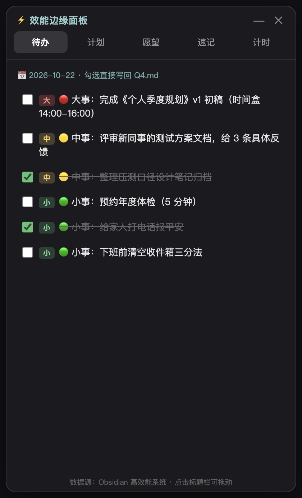
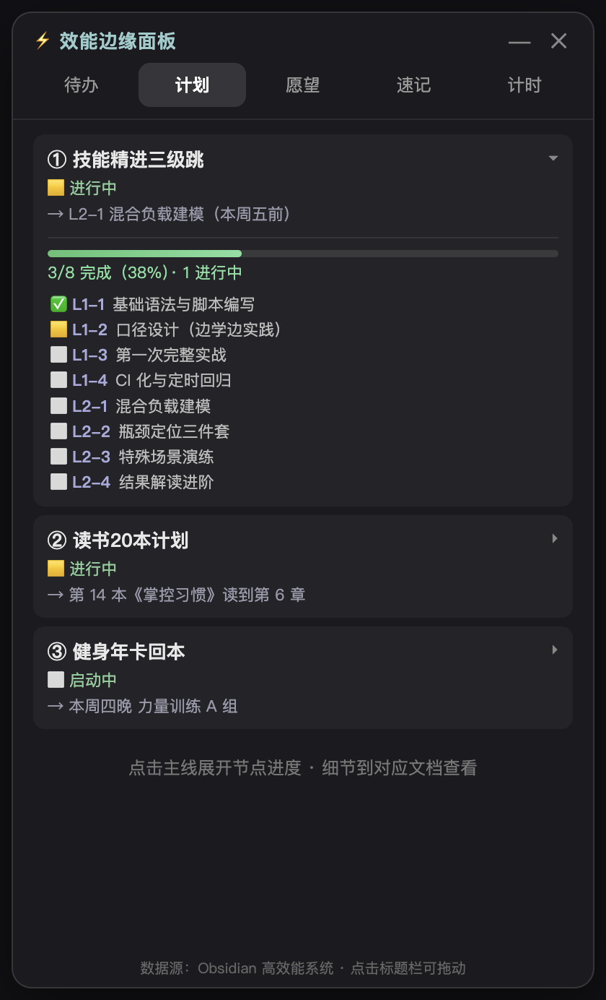
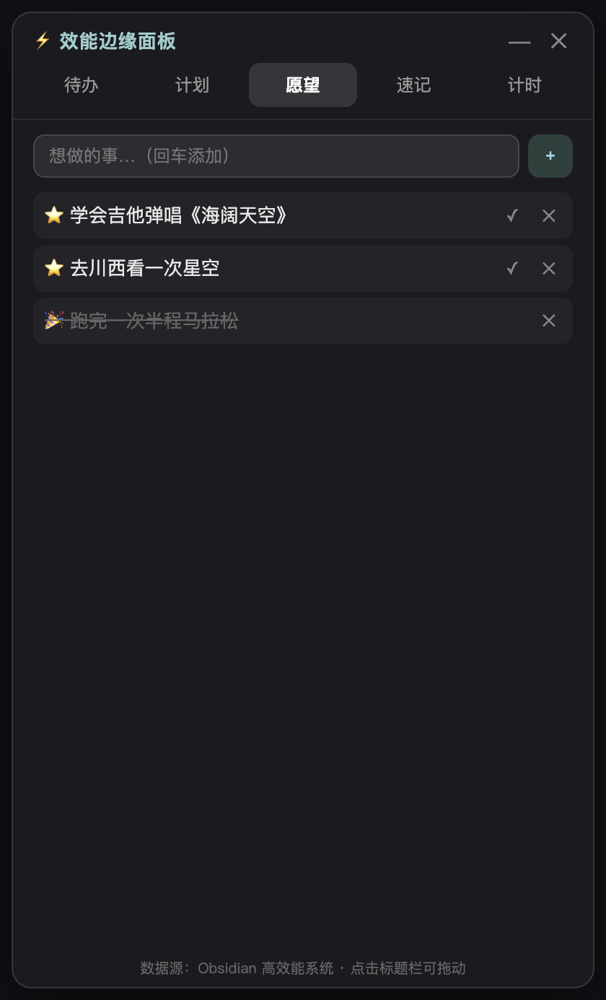
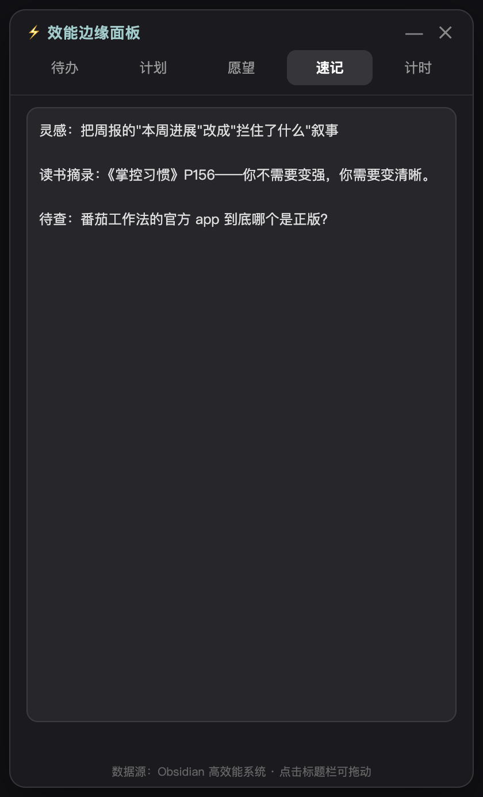
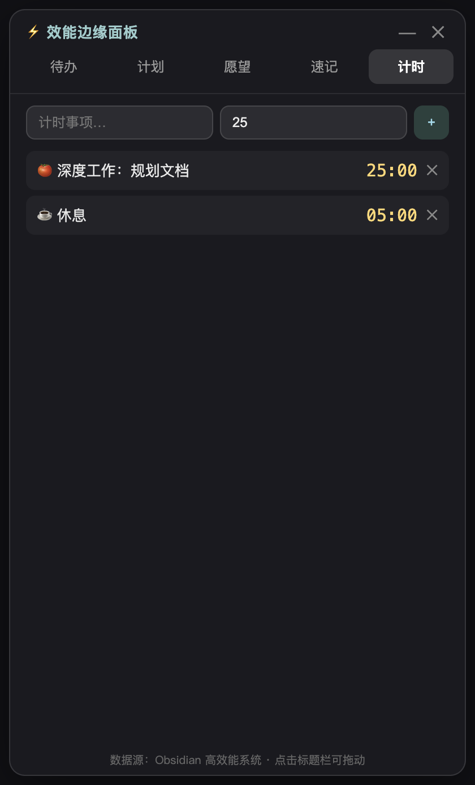

# ⚡ 效能边缘面板（Edge Todo Panel）

> 吸附在 macOS 屏幕左下角的玻璃质感效能面板——待办、计划、愿望、速记、计时五合一。
> 与 Obsidian 高效能系统（`2026-Q4.md` / `ROADMAP.md`）**双向同步**：面板勾选待办 = 直接写回 markdown。

## 效果展示（虚拟数据）

> 以下截图均为 demo 模式虚拟数据，与真实文件无关。

### 待办（今日 1-3-5）

从 `2026-Q4.md` 今日 section 实时解析，勾选即写回文件。



### 计划（8 条主线 + 点击展开节点进度）

从 `ROADMAP.md` 解析主线看板；点击任意主线展开该路线图文档的节点清单与完成率。



### 愿望 / 速记 / 计时

愿望箱本地存储（达成打 🎉）；速记自动保存；计时器到点系统通知。

| 愿望 | 速记 | 计时 |
|------|------|------|
|  |  |  |

### 翻译（谷歌翻译）

源语言自动检测，目标 8 种语言，`Ctrl+Enter` 快捷翻译，译文可选中复制。

## 怎么用

### 启动

```bash
cd ~/Documents/AIIIII/edge-todo-panel
npm install          # 首次
./panel.sh restart   # 一键启动/重启
```

面板启动后**自动吸附在屏幕左下角**，只剩一条 8px 细边。

### 手动重启与故障自救

```bash
~/Documents/AIIIII/edge-todo-panel/panel.sh restart   # 重启（最常用）
~/Documents/AIIIII/edge-todo-panel/panel.sh status    # 查运行状态
~/Documents/AIIIII/edge-todo-panel/panel.sh log       # 看日志
~/Documents/AIIIII/edge-todo-panel/panel.sh stop      # 停止
```

侧边滑出失效、面板消失等故障的**分症状排查步骤**见 [自救手册.md](自救手册.md)——核心原则：先试 `Cmd+Shift+P` 和托盘图标（独立入口），不行再 `panel.sh restart`，还不行按手册对症排查。

### 打开面板的三种方式

| 方式 | 操作 | 适用场景 |
|------|------|---------|
| ① 左下角热区 | 鼠标移到任意屏幕的**左下角**（贴左缘 + 底部 240px 高区域） | 日常最顺手 |
| ② 菜单栏托盘图标 | 点顶部菜单栏右侧的 ⚡ 图标（或右键选"展开面板"） | 鼠标在屏幕中央不想跑角落 |
| ③ 全局快捷键 | `Cmd+Shift+P` 切换展开/收起 | 键盘党、录屏演示 |

### 收起面板

- 鼠标**离开面板区域**约 20px 以上 → 自动收起
- 点标题栏 `—` 按钮 → 手动收起
- 再按一次 `Cmd+Shift+P`

### 其他操作

| 动作 | 效果 |
|------|------|
| 拖标题栏 | 移动面板位置（收起后回到左下角） |
| 拖面板**右/下边缘** | 调整窗口大小（展开态调整后收起再展开保持新尺寸） |
| 点 `✕` | 完全退出面板 |

### 多显示器规则

- 面板**停留在它当前所在的屏幕**，不会因为光标跑到别的屏就跟着跑
- 想让面板换屏幕：把光标移到**目标屏幕的左下角热区**，面板会迁移过去并滑出
- 展开状态下不跨屏迁移（避免面板突然跳屏）；收起后恢复跟随

### 数据同步说明

| 数据 | 存哪 | 面板操作的影响 |
|------|------|---------------|
| 今日待办 | `高效能系统/2026-Q4.md` 当日 section | 勾选/取消勾选 = 修改文件复选框；文件被外部修改后面板自动刷新 |
| 计划主线 | `高效能系统/ROADMAP.md` + 各路线图文档 | 只读展示（点击展开节点进度） |
| 愿望/速记/计时 | 本地 `~/Library/Application Support/edge-todo-panel/` | 仅面板内使用，不碰 markdown |

### Demo 模式（虚拟数据，不碰真实文件）

```bash
DEMO_PANEL=1 npm start
```

用于体验和截图，所有 tab 显示内置虚拟数据，写操作不落盘。

## 环境要求

- macOS（窗口吸附逻辑基于 `screen` API 的 workArea，Windows/Linux 未适配）
- Node.js 18+
- Electron 33+（`npm install` 自动装）

## 目录结构

```
edge-todo-panel/
├── main.js            # 主进程：窗口、IPC、fs.watch
├── edge-dock.js       # 吸附引擎（热区检测/滑出收起/多屏迁移）
├── preload.js         # 上下文桥（window.P）
├── q4-sync.js         # Q4.md 解析与复选框写回
├── roadmap-sync.js    # ROADMAP 主线 + 路线图节点解析
├── panel-store.js     # 愿望/速记/计时本地存储
├── renderer/
│   ├── index.html     # 玻璃面板样式
│   └── app.js         # 五 tab 渲染逻辑
├── shot-demo.js       # demo 截图生成脚本（开发用）
└── docs/              # 效果展示截图
```

## 已知限制

- 待办解析只认 `- [ ]` / `- [x]` 复选框行（含 🔴🟡🟢 优先级识别）
- 计划节点解析依赖路线图文档的表格/复选框格式，格式变化需同步改 `roadmap-sync.js`
- 面板不开机自启（v0.2 计划：登录项 + 快捷键唤出）
